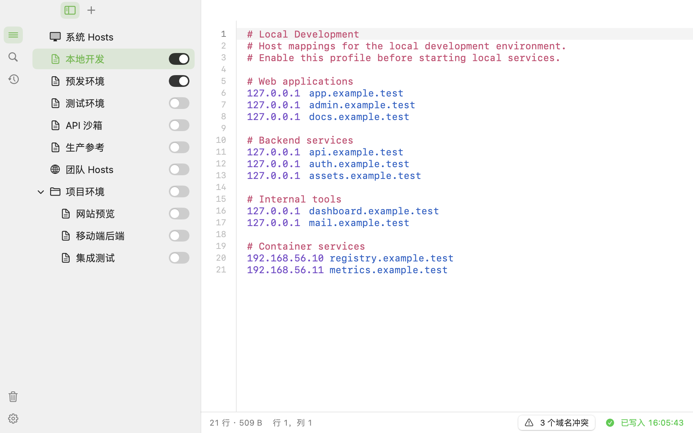
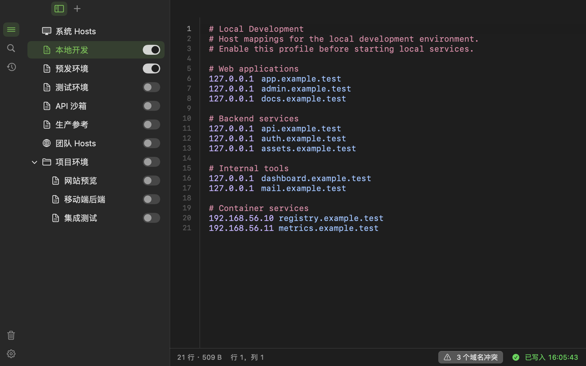
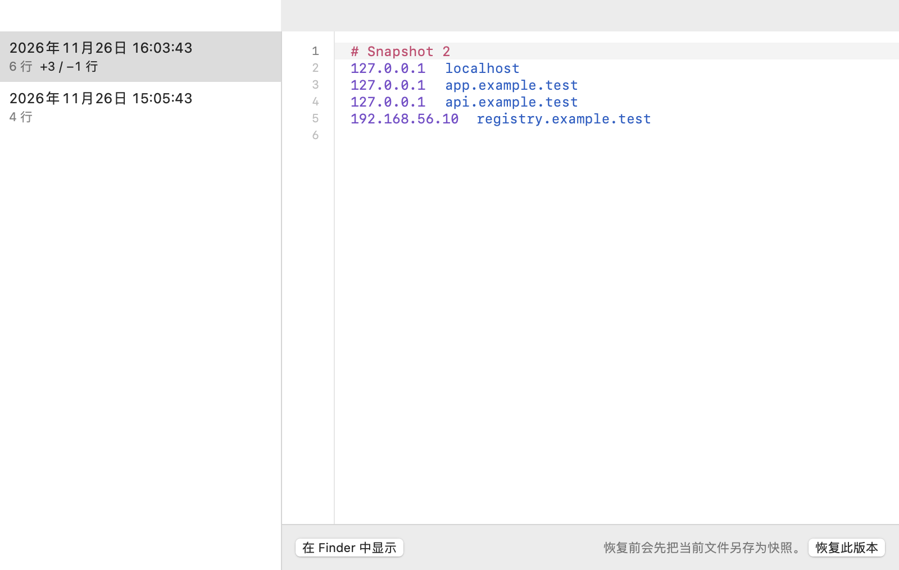
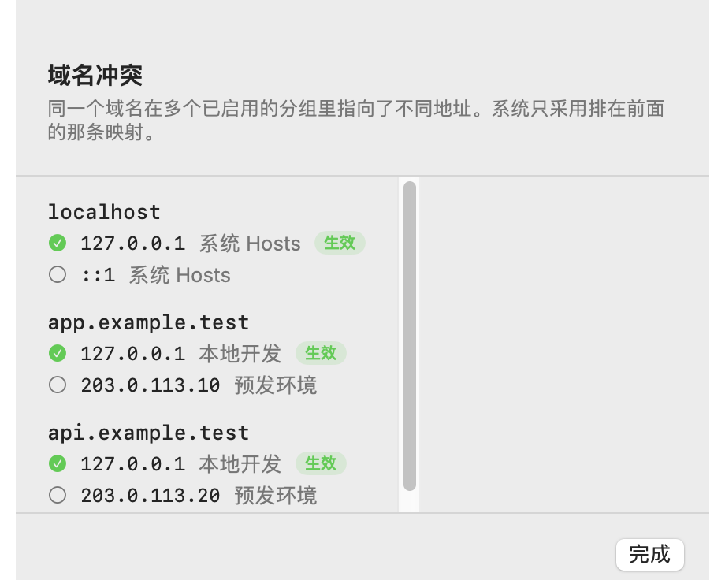
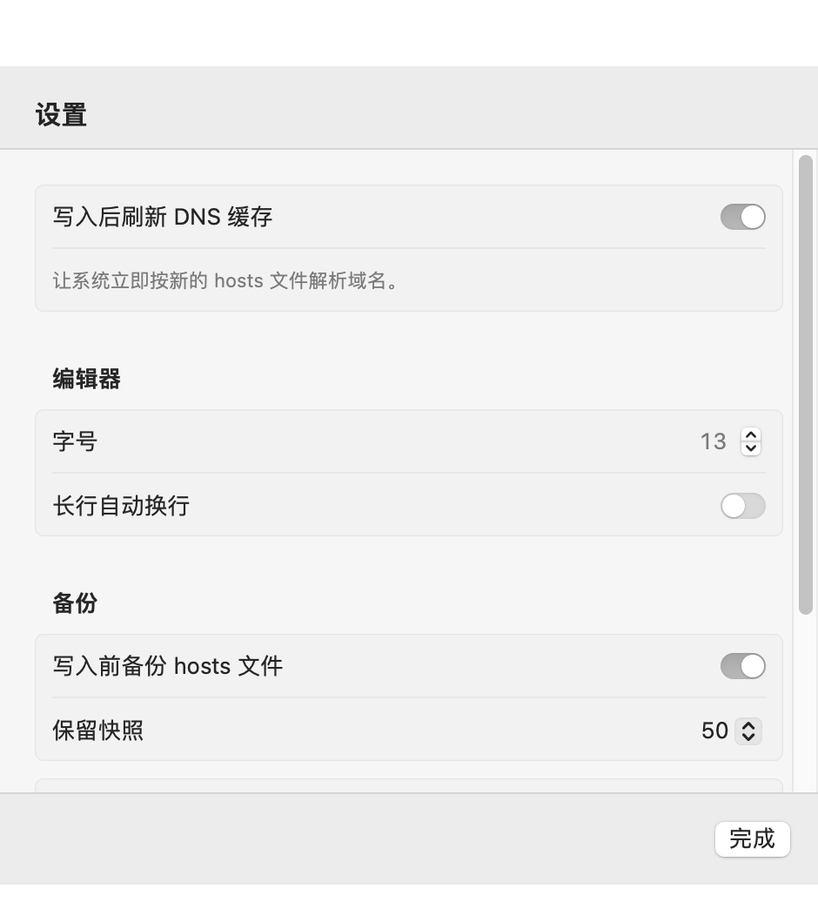
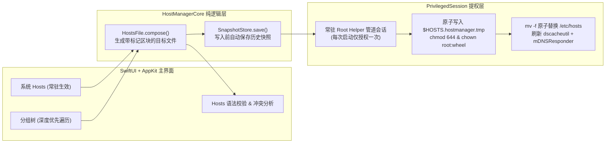
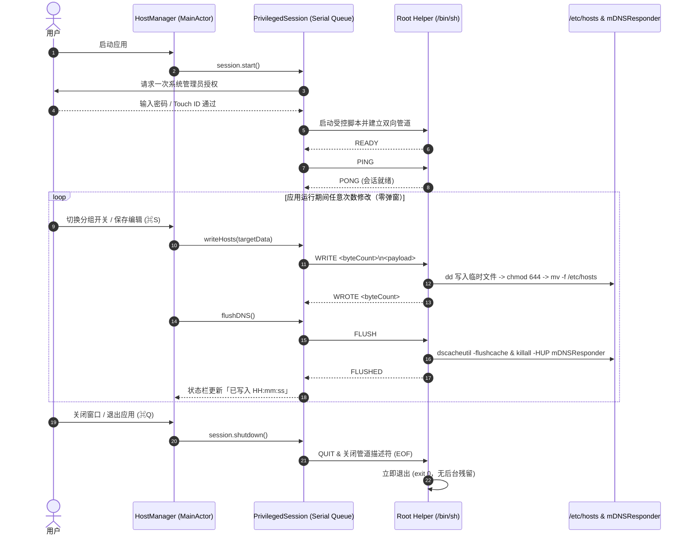

<div align="center">


# HostManager

**原生、轻量、零后台驻留的 macOS `/etc/hosts` 分组管理工具**

[](https://www.apple.com/macos/)
[](https://swift.org)
[](Sources/HostManager)
[](Sources/HostManager/Privilege/PrivilegedSession.swift)
[](Resources)

[界面预览](#-界面预览) · [核心特性](#-核心特性) · [架构与原理](#-架构与工作原理) · [快速开始](#-快速开始) · [快捷键](#-快捷键一览) · [项目结构](#-项目结构)

</div>

---

## 📖 简介

**HostManager** 是一款专为 macOS 打造的原生 Hosts 分组切换与编辑工具。它采用 **SwiftUI + AppKit** 纯原生构建，无任何第三方依赖，无需完整 Xcode（仅需 Command Line Tools 即可编译打包）。

与其他需要安装常驻 Root 守护进程（`LaunchDaemon`）或每次保存都要重复输入管理员密码的工具不同，HostManager 采用**生命周期绑定的单次提权会话**：

> [!TIP]
> **一次授权，全程无感；退出即焚，零后台残留。**
> 打开应用时仅需授权一次管理员密码，应用运行期间切换任意分组、保存编辑、刷新 DNS 均**瞬间完成且不再弹窗**；关闭窗口退出应用时管道自动断开，提权子进程立即随之退出，不在系统中留下任何后台服务或驱动文件。

---

## ✨ 界面预览

### 主窗口（浅色 / 深色模式自适应）

| ☀️ 浅色模式 (Light Mode) | 🌙 深色模式 (Dark Mode) |
| :---: | :---: |
|  |  |

### 历史快照回滚 · 域名冲突检测 · 偏好设置

| 🕒 历史快照与行级变更对比 | ⚠️ 跨分组域名冲突检测 | ⚙️ 偏好设置 |
| :---: | :---: | :---: |
|  |  |  |

---

## 🚀 核心特性

### 1. 🌳 树状多级分组与灵活编排
- **无限层级嵌套**：支持按项目、环境（本地开发 / 预发 / 测试 / 生产参考）创建多级父子分组。
- **级联开关控制**：关闭父分组时，其下所有子分组自动级联停用；当子分组开启但上级分组处于关闭状态时，顶部横幅智能提示并提供**「开启上级分组」**一键激活。
- **自然拖拽排序**：支持在侧边栏直接拖拽分组调整先后顺序（决定域名冲突时的优先级）或拖入其他分组成为子分组。
- **自定义图标**：内置 20+ 常用 SF Symbols 图标选择器，也支持根据是否存在子分组自动切换文件夹/文档图标。

### 2. 🔐 单次授权 · 原子写入 · 零守护进程
- **单次授权常驻会话**：启动时申请一次管理员权限，建立绑定当前进程生命周期的受控 Root Helper 管道会话；若主提权接口受限，自动切换至私有 `0700` FIFO 常驻会话兜底，同样只需授权一次。
- **窄接口最小权限设计**：提权 Helper 仅暴露 `PING`、`WRITE <n>`、`FLUSH`、`QUIT` 四条定长/行协议指令，上限校验（16 MB），所有系统二进制均通过绝对路径调用并隔离标准流。
- **同卷原子替换 (`rename(2)`)**：写入时先在同卷生成临时文件、校验字节数并设置 `644` (`root:wheel`) 权限，最后通过 `mv -f` 原子替换 `/etc/hosts`，确保系统解析器在任何时刻都不会读到写了一半的残缺文件。

### 3. ⚡ 专业级 Hosts 语法高亮编辑器
- **原生高性能编辑体验**：基于 `NSTextView` 与自定义 `NSTextStorage` 构建，每个分组独立维护撤销栈（Undo History）与滚动位置。
- **实时语法高亮与校验**：
  - 注释行（`# ...`）、IPv4 / IPv6 地址（含压缩与 IPv4 内嵌格式）、主机名分别着色；
  - 对不符合 `/etc/hosts` 语法的无效行实时绘制红色下划线警告，并在底部状态栏汇总异常行数；
  - 支持行号显示、当前光标所在行高亮、字号调节（`10pt ~ 18pt`）、长行自动换行开关及关键词高亮定位。

### 4. 🛡️ 外部修改感知与系统安全防护
- **非侵入式块标记协议**：通过 `# >>> HostManager: 分组名 [shortID] >>>` 与 `# <<< ... <<<` 标记托管区，完整保留系统原有的基础条目。
- **外部修改无感融合**：若其他软件（如 VPN、Docker、容器工具）在后台修改了 `/etc/hosts` 的非托管区域，HostManager 在下次应用时会自动保留外部改动而不静默覆盖；若启动时检测到外部修改，主动提示一键导入或忽略。
- **`localhost` 误删拦截**：当检测到用户试图删除系统 Hosts 中最后一条 `127.0.0.1 localhost` / `::1 localhost` 映射时，弹出风险确认框并提供**「插入 macOS 默认条目」**快捷修复。

### 5. 🕒 自动历史快照与 DNS 缓存即时刷新
- **写入前自动备份**：每次更新 `/etc/hosts` 前自动在本地生成时间戳快照（如 `2026-11-26_14-53-45.hosts`），直观展示每个版本相对于上一版本的 `+新增 / −移除` 行数，支持一键回滚并自动按保留上限清理旧快照。
- **DNS 缓存自动刷新**：每次写入完成后自动执行 `/usr/bin/dscacheutil -flushcache` 并向 `mDNSResponder` 发送 `HUP` 信号，无需手动在终端敲命令即可立即生效。

---

## 🧩 架构与工作原理

### 1. 分组合成与安全写入流程



### 2. 单次授权常驻会话时序



---

## 🛠️ 快速开始

### 环境要求
- **操作系统**：macOS 14.0 (Sonoma) 及以上
- **编译工具**：仅需 **Xcode Command Line Tools**（`swift`、`codesign`），无需安装完整 Xcode：
  ```bash
  xcode-select --install
  ```

### 一键编译与安装

克隆仓库并执行内置构建脚本 [build.sh](build.sh)：

```bash
git clone https://github.com/liangtengyu/hostManager.git
cd hostManager

# 1. 编译 Release 版本并打包至 dist/HostManager.app
./build.sh

# 2. 编译并直接安装到 /Applications/HostManager.app
./build.sh --install

# 3. 快速编译 Debug 版本（适合本地开发调试）
./build.sh --debug
```

构建完成后，直接运行：

```bash
open dist/HostManager.app
```

### 开发沙箱模式（免密码调试）

开发调试 UI 或分组逻辑时，可通过环境变量指定沙箱 `hosts` 文件与数据目录，此时应用会自动进入**开发模式**（无需管理员密码，也不会修改系统 `/etc/hosts`）：

```bash
HOSTMANAGER_HOSTS_PATH=/tmp/scratch-hosts \
HOSTMANAGER_DATA_DIR=/tmp/hostmanager-dev \
dist/HostManager.app/Contents/MacOS/HostManager
```

---

## ⌨️ 快捷键一览

| 快捷键 | 功能说明 |
| :--- | :--- |
| `⌘N` | 新建顶级分组 |
| `⇧⌘N` | 在当前所选分组下新建子分组 |
| `⌘S` | 保存当前分组内容并立即写入 `/etc/hosts` |
| `⌘E` | 开启 / 关闭当前所选分组（立即生效） |
| `⌘F` | 展开侧边栏并聚焦搜索框（支持按分组名与主机名过滤） |
| `⇧⌘H` | 打开「历史快照」面板，对比差异或恢复历史版本 |
| `⌘,` | 打开「设置」面板 |
| `⌘⌫` / `Delete` | 删除当前所选分组（系统 Hosts 分组受保护不可删除） |
| `↑` / `↓` | 在侧边栏分组列表中上下移动选择 |
| `Return` / `双击分组行` | 展开/折叠父分组，或重命名普通分组并修改图标 |
| `Esc` | 退出搜索或关闭当前弹窗 |

---

## 📂 项目结构

项目采用 `HostManagerCore`（纯 Foundation 核心逻辑层）与 `HostManager`（SwiftUI + AppKit 视图与系统交互层）分离的双 Target 架构：

```text
hostManager/
├── Package.swift                  # Swift Package Manager 清单 (macOS 14+)
├── build.sh                       # 一键编译、打包 .app Bundle 与 Ad-hoc 签名脚本
├── Resources/
│   ├── Info.plist                 # 应用 Bundle 元信息
│   ├── HostManager.icns           # 应用图标
│   ├── zh-Hans.lproj/             # 简体中文国际化文案
│   └── en.lproj/                  # 英文国际化文案
├── Scripts/
│   └── make-icon.swift            # 纯 AppKit 矢量绘制应用图标生成脚本
└── Sources/
    ├── HostManagerCore/           # 核心领域逻辑（无 AppKit 依赖）
    │   ├── HostGroup.swift        # 分组模型与系统分组定义
    │   ├── GroupTree.swift        # 树状分组遍历、搜索过滤、拖拽移动算法
    │   ├── HostsSyntax.swift      # Hosts 语法解析器（IPv4/IPv6/主机名/注释校验）
    │   ├── HostsFile.swift        # 标记区块合成、解析、localhost 检测与域名冲突计算
    │   ├── HostsImporter.swift    # 首次启动导入与外部改动合并算法
    │   ├── HelperScript.swift     # 提权 Shell 协议脚本与命令生成器
    │   ├── SnapshotStore.swift    # 历史快照存储与自动淘汰管理
    │   └── StoreDocument.swift    # 应用配置、路径解析与 SHA-256 摘要
    └── HostManager/               # macOS 原生界面与提权会话层
        ├── HostManagerApp.swift   # 应用入口与生命周期委托
        ├── AppModel.swift         # 全局可观测状态 (@Observable) 与业务编排
        ├── HostManagerCommands.swift # 菜单栏命令与快捷键绑定
        ├── QuitGuard.swift        # 未保存修改退出/关窗拦截保护
        ├── SampleGroups.swift     # 首次启动示例环境分组
        ├── Privilege/
        │   ├── PrivilegedSession.swift   # 单次授权常驻提权会话与 FIFO/osascript 兜底
        │   └── AuthorizationHandle.swift # Security.framework 权限句柄封装
        ├── Editor/
        │   ├── HostsEditorView.swift     # NSTextView + 行号栏 + 状态协同封装
        │   └── HostsTextStorage.swift    # 自定义 NSTextStorage 实时语法着色
        ├── Views/
        │   ├── RootView.swift            # 沉浸式透明标题栏主窗口布局
        │   ├── SidebarView.swift         # 支持拖拽排序与折叠的分组树侧边栏
        │   ├── GroupDetailView.swift     # 编辑器主视图、顶部提示横幅与底部状态栏
        │   ├── Sheets.swift              # 新建/重命名、历史快照、冲突详情、设置弹窗
        │   └── Components.swift          # 紧凑开关、侧边栏毛玻璃材质与通用组件
        └── Support/
            ├── L10n.swift                # 本地化字符串工具
            └── Theme.swift               # 浅色/深色主题调色板与语法高亮配色
```

---

## 💾 数据存储说明

所有应用数据均保存在当前用户的标准应用支持目录下，卸载应用时直接删除该目录即可，不污染系统其他位置：

- **配置文件**：`~/Library/Application Support/HostManager/config.json`
- **历史快照**：`~/Library/Application Support/HostManager/history/*.hosts`
- **提权日志**：`~/Library/Application Support/HostManager/privilege.log`
